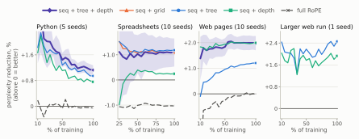
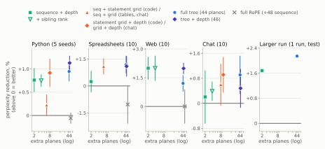
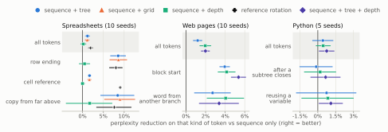
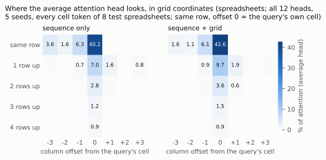

# Appendix

Every number here is recomputed from the run logs by
`audit_paper_numbers.py`, which reads this file alongside the paper. The interactive appendix at
`docs/index.html` presents the same results with per-seed detail and per-seed markers.

## Figure 3. Each configuration's gap to sequence only over training

*Figure 3. Perplexity reduction against sequence only at every validation checkpoint (above 0 = better): mean
over seeds of the paired gap; band, 95% CI for sequence + tree + depth. Each panel has its own
scale; spreadsheets from 25% of training. On code the gain narrows as training proceeds; on web pages it
holds or grows.*

## Figure 4. Gain against the number of extra planes

*Figure 4. Perplexity reduction against sequence only (above 0 = better) against the number of extra
rotary planes each configuration costs, log scale. Marker: mean over seeds of the paired gap; line:
95% CI; the larger web run is one run each, on its test split. Green: depth and depth with a label; orange: a
grid (the statement grid on code; row and column on spreadsheets; exchange, speaker and position on
chat), with depth where marked; blue: the full 44-plane tree; violet: tree + depth; grey: all 64
planes rotated by sequence. A cheap coordinate reaches the full tree in every setting; which one
depends on the data. Every label-on-depth variant is in the interactive appendix.*

## Other findings (body §5.2)

**Where the gain lands.** Split by what is predicted, on the test split, the gain concentrates on
structural tokens. On spreadsheets, the end of a row improves by 8.6% under sequence + tree and
8.6% under sequence + grid (10/10), against 1.2% and 1.1% on average; a value copied from the cell
above across ≥ 256 tokens by 8.5% and 9.0%. On web pages, the first token of a new text block improves
by 4.0–5.4% under every structured configuration (10/10), against 1.2–2.0% on average; full RoPE
helps no kind of token. On Python, gains are spread evenly; the largest negative values, on tokens
right after a subtree closes, are within noise. These are likelihoods, not task accuracy. Figure 5 breaks the gain down by kind of token.

*Figure 5. Perplexity reduction against sequence only on selected kinds of token, test split
(right = better); marker, mean over seeds; line, 95% CI; shaded row, all tokens. Each panel has its
own scale. Every category, with per-seed markers, is in the interactive appendix.*

**Reference rotation** improves on sequence + tree by 0.88% on spreadsheets (9/10, q < 0.05), by
0.39% when every address is also written out as text (7/10, q < 0.05), and not on Python (−0.15%,
2/5), whose renamed identifiers already make each reference a string match. On cell references
themselves the gain is 9.1% against sequence only.

**Adding versus replacing; one head versus separate layers.** Replacing the sequence index with the
tree helps on Python (tree only, 0.41%, 20/20, q < 0.05) but hurts on the larger web run (−1.70%, test), where
there are 0.12 nodes per token. Splitting sequence and tree into separate layers is
worse than sharing each head on Python (−0.22%, 0/5, q < 0.05) and suggestive of better on spreadsheets (0.73%,
5/5, p = 0.097). Learning curves, these splits and per-category tables are in the interactive appendix.

## How the structure is used (body §5.2)

**The models rely on the structure.** Scoring the same test text with each record's coordinates
shuffled among its own tokens costs far more than the structure gained, on every seed (5/5):
sequence + grid on spreadsheets gains 1.4% but loses 29% when shuffled (12% when removed);
sequence + depth on web pages gains 2.0% and loses 18% (5.4%). On Python, shuffling depth multiplies
perplexity 7.5×: with no brackets or indentation in the stream, the model hands its nesting
bookkeeping to the rotation. Removing the structure is out of distribution there, so shuffling is
the cleaner test.

**Attention moves where the gain lands** (Figure 6). Averaged over all heads, the grid shifts
attention onto earlier cells of the same column (14.2% → 18.5%, 5/5, q < 0.05) and onto the
referenced cell (+0.55 points, 5/5, q < 0.05); depth on web pages shifts it onto text at the same depth
elsewhere on the page (+1.8 points, 5/5, q < 0.05). On Python the shift is only suggestive (onto ancestor nodes, +0.5 points, 4/5, p = 0.062).
Individual heads move 15–37 points in either direction, so heads are reassigned rather than nudged,
and a sequence-only model also grows a column-reading head; the grid spreads that behaviour across
more of the network. Full tables, and what switching the rotation off does to the attention scores, are in the interactive appendix.

*Figure 6. Attention of the average head (all 12 heads, 5 seeds) from a spreadsheet cell to cells
in the same row and in the rows above, by column offset, test split. The grid moves attention from
cells to the left onto the same column in earlier rows.*

## Table 1. The five settings

| | Python | Spreadsheets | Web | the larger web run | Chat |
|---|---|---|---|---|---|
| corpus | 423,111 programs | 41,245 workbooks | 899,382 web pages | 17.19 M web pages | 295,386 conversations |
| tokens | 47.1 M | 43.3 M | 896 M | 25.4 B | 212 M |
| tree | syntax tree | sheet → row → column → cell contents | DOM of visible text (markup stripped) | DOM of visible text (markup stripped) | exchange → speaker → Markdown |
| tree nodes per token | 0.86 | 0.56 | 0.13 | 0.12 | 0.03 |
| layers / heads / width | 6 / 2 / 256 | 6 / 2 / 256 | 6 / 2 / 256 | 10 / 4 / 512 | 6 / 2 / 256 |
| non-embedding parameters | 4.7 M | 4.7 M | 4.7 M | 31.5 M | 4.7 M |
| context (tokens) | 1,024 | 4,096 | 2,048 | 4,096 | 2,048 |
| training | 11,200 steps, 8 epochs | 8,240 steps, 8 epochs | 9,375 steps, ⅓ epoch | 537,000 steps, 1 epoch | 13,100 steps, 1.4 epochs |
| seeds per configuration | 5 (20 for tree only and sequence only) | 10 | 10 | 1 | 10 |

*Table 1. The five settings.*

## Depth dropout, in full

<!-- ctl:DROP -->**Withholding depth on part of the training data.** Training web pages with depth dropped on a random 30% of records — the coordinate absent there, contributing no rotation — keeps most of the reading gain and removes the harm when depth is missing. With depth supplied it gains 1.49% (9/10, q < 0.05) against sequence only, where plain depth gains 2.00% (10/10, q < 0.05); without it, −0.42% (4/10, n.s.), where a model trained with depth always present is 3.30% worse than sequence position alone (0/10). At 50% dropout the pair is 1.23% (9/10, q < 0.05) and −0.07% (5/10, n.s.). **One model can therefore serve both regimes: read structured documents with the marker, generate free text without it. Use depth where the structure is in the text or available at inference; where it may be missing, withhold it on part of the training data.**<!-- /ctl:DROP -->

## Run-to-run noise and the Python splits (body §4, §5.1)

**The noise floor.** GPU training here is not bit-reproducible: replicate runs of one
configuration at one seed are identical at step 0 and diverge thereafter through floating-point
reduction order. Three replicate runs of one configuration at one seed on web pages spread 0.0023 nats at the final step against 0.0109 across the ten published seeds — 21% of the spread
the pairing removes, and 11% of the depth effect measured against it.

**Why Python's two splits disagree.** Python's test split shows smaller gains for every configuration (sequence only scores 0.43 nats/token there against 0.35 on validation). The splits are contiguous record ranges over an unshuffled
corpus: mean record length is 108.5 tokens in train, 127.9 in validation and 117.9 in test, and
the subsets actually scored are 130.0 and 114.5. Validation is also easier than the training
data: at the end of training, loss is 0.536 on training batches against 0.348 on the validation
set. The body therefore reads the test column as the less idiosyncratic of the two and treats
the Python effect as uncertain.

## The two-corpus precursor (body §5.4)

An earlier two-corpus version of the four-corpus experiment, superseded by it and reported here
for completeness.

<!-- ctl:MIX2 -->A two-corpus precursor (web pages and spreadsheets, five seeds, test split) found the same split of preferences: depth 2.86% (5/5, q < 0.05) on web against the grid's −0.26% (2/5, n.s.) there, and the grid 1.35% (5/5, q < 0.05) on spreadsheets. It also found that two corpora writing different meanings into one plane group cost nothing against giving each its own, 0.02% (3/5, n.s.). Full tables for both cells follow below.<!-- /ctl:MIX2 -->

## Published orderings for the injection site (body §6)

GRAPE's own experiments (Zhang, Y. et al., 2026) favour the additive site: 51.73 average accuracy for RoPE against 52.87
for ALiBi and 53.25 for its additive variant at 353M parameters. PaTH's (Yang et al., 2025) favour the
multiplicative: 19.01 perplexity against 18.03 for its own and 18.33 for an additive
data-dependent logit term. Neither holds the injected coordinate fixed while varying the route.
