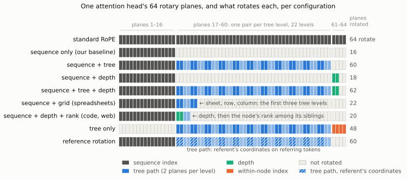
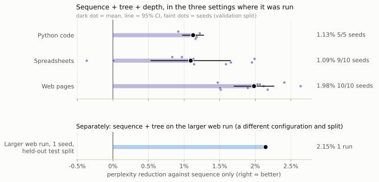

# Depth Perception for Transformers: Telling Models How Deeply Each Token Is Nested

*Will Rodenbusch · will@rodenbusch.org · Preprint, 2026-10-15.*
*Code, data builders and interactive appendix: <https://github.com/wrodenbusch/depth-perception>*

## Abstract

This paper has multiple tables. A language model will receive them as one sequence of tokens,
with the arrangement left to infer. Nearly every document a model reads has more structure than
just sequence, and that structure is free whenever the data is prepared. We propose the smallest
way to give it to the model: a **depth marker**, two of the 64 rotary planes in each attention
head (3% of them, no added parameters), rotated by how many levels of structure enclose each
token, alongside unchanged sequence position. Training decoder-only models from scratch on code,
web text, spreadsheets and chat, we compare it against the token's full tree path on 44 planes.
Depth recovers most of the full path's benefit on nested text at about a twentieth of the cost,
lowering perplexity by roughly 1–2%; where the data is shaped as a grid, a second small
coordinate carries the gain instead. One model serves all four corpora from a single shared
coordinate, with no domain label at inference. Controls attribute the gain to the structural information. Our models are small (up to 31.5M parameters), so
whether the gain persists at scale is open.

## 1. Introduction

The mechanism that carries position into a transformer has changed since 2017: from sinusoidal and
learned absolute embeddings (Vaswani et al., 2017), through relative schemes (Shaw et al., 2018;
Raffel et al., 2020; Press et al., 2022), to rotary ones (Su et al., 2024). Decoders can even
learn without explicit positions (Kazemnejad et al., 2023). Yet the information has not changed:
one integer per token, counted from the start of the sequence. The documents
these models train on are not flat. Serialising a syntax tree, a DOM or a spreadsheet keeps the order
and discards the nesting, which a model must partly relearn. Relearning it is not free. Yao et al. (2021) show that bounding the nesting depth makes
hierarchical languages tractable for self-attention. They give a two-layer construction whose
first layer spends itself computing each token's depth, before the second can use it.  Web pretraining pipelines go further: they
parse each page's HTML, keep the main text and discard the structure (RefinedWeb and FineWeb use
trafilatura; Penedo et al., 2023; 2024). Keeping the markup costs 70% of a page's tokens in our data
and gives a sequence-only model nothing (§5.2); a depth marker keeps the structure at no token cost.

**What we add.** We tested many ways of putting a document's structure into the position channel, on disjoint
planes of the rotary heads a model already runs. The candidates were a token's full path through
the document tree, its nesting depth alone, grid coordinates for tables and chat turns, a
statement grid for code, labels marking a token's siblings or its parent, and reference rotation,
where a referring token takes its referent's coordinates. The finding is that the cheapest of them does
most of the work. A **depth marker** — two planes carrying how deeply a token is nested, beside
unchanged sequence position — recovers most of what the 44-plane tree path gives, and on
grid-shaped data one further small coordinate carries the rest. One model trained on all four corpora shares a single depth coordinate across them; private per-corpus pairs cost four times the planes and buy no gain we can resolve (§5.4). Everything is measured the same way:
decoder-only models trained from scratch, paired seeds, and sequence-only and full-RoPE controls.

Full setup, per-seed results, learning curves, the layer and head splits, per-category tables
and the mechanism diagrams are in the interactive appendix: <https://wrodenbusch.github.io/depth-perception/>.

## 2. Related work

Tree positional encodings for code add tree coordinates to the input (Shiv & Quirk, 2019), or to
the attention score as a soft bias (Peng et al., 2022). A syntax-informed prior for text is
injected into absolute, relative and rotary encodings alike, and for decoders works best in the
position pathway rather than the input (Riaz et al., 2026). Hierarchical documents have been given
per-level indices (He, H. et al., 2024). Depth, sibling rank and parent identity have been
embedded jointly for HTML, as six position channels summed into the input (Deng et al.,
2022), and as a (depth, sibling index) pair for code ASTs (Bartkowiak & Graliński, 2025). Others carry structure through
the input or the pretraining task rather than position: XPath embeddings for HTML (Li, J. et al.,
2022), 2D layout coordinates for scanned documents (Xu, Y. et al., 2020), data-flow edges for code
(Guo et al., 2021), syntax-aware span corruption (Gong et al., 2024), and structural biases in graph
attention (Ying et al., 2021). Algebraic positional encodings read a domain's path algebra as orthogonal operators (Kogkalidis et
al., 2024). That recovers RoPE as the sequential case, and extends to trees by composing one
learned rotoreflection per branch choice along the root path. Their tree experiments are synthetic
encoder-decoder transduction, and no depth-only reduction of such a path encoding is evaluated. The rotation family has been studied for continuous spatial coordinates. LieRE learns dense
rotation generators for 2D and 3D vision (Ostmeier et al., 2025). STRING proves a universality
result for translation-invariant encodings expressible by matrix multiplication (Schenck et al.,
2025).  What that line does not address is which *discrete structural*
coordinate is worth spending planes on in a language model, which is what we measure.

Two papers come closest. Pushdown Layers (Murty et al., 2023) adds per-token constituent depth from an incremental parse to
attention keys, as a learned embedding. It reports 20.1 to 19.9 perplexity on sentence-level
BLLIP-LG — gains they call slight — with better syntactic generalisation. Its coordinate estimates *latent* syntax: silver parses from a trained parser, a supervised
attachment head at inference, and parse recovery scored against treebank gold. Ours is read from
structure the format states. It needs no parser trained on annotations and admits no distribution
over alternatives, though malformed input still needs a recovery convention. Its injection is also more expressive than our additive
control: a vector inside the bilinear form, not a vector added at the input. MapFormers (Rambaud et al., 2025) makes the rotary angle input-dependent. A low-rank projection of
each token's representation gives a per-block increment, accumulated by cumulative sum; a fixed
increment recovers RoPE exactly. Their 12-layer model, pretrained on OpenWebText at a larger token
budget than ours, improves perplexity over a RoPE baseline, 19.14 to 18.79. An input-dependent rotary angle
improving natural-corpus perplexity is therefore already published. Three things separate that result from ours. First, their increment is learned without
supervision, which is their central claim, and no variant supplies it. Second, they decline to
attribute the natural-language gain to hierarchy, noting BLiMP shows no clear improvement. Third,
every experiment in which they demonstrate structure learning is single-layer and single-head, so
the increment there is a function of token identity. That is enough for depth in Dyck-2, where an
open bracket adds one and a close subtracts one. It is not enough for HTML, Python or
spreadsheets, where implicitly closed elements, string literals and comment context make depth a
function of the prefix rather than the token.

HiRoPE splits a head's rotary planes between a token index and code hierarchy levels, for length
extrapolation in a pretrained model (Zhang et al., 2024). Dependency-tree depth has been fused with
sequence position for translation (Wang, X. et al., 2019). Multi-axis RoPE partitions planes among
image and video axes (Heo et al., 2024; Wang, P. et al., 2024), and rotary encodings have been built
from graph structure (WIRE; Reid et al., 2025). That line subsumes our grid result: recovering RoPE on Cartesian grids is WIRE's own theorem, and
a table is a grid. It does not subsume depth. Laplacian spectra are direction-blind, while depth
in a rooted tree is inherently directed, which is why direction-aware encodings need a Magnetic
Laplacian (Geisler et al., 2023). For tables, row and column enter as
learned embeddings (Herzig et al., 2020; Wang, Z. et al., 2021) or row- and column-wise RoPE
orderings (Li, J.-N. et al., 2025). Other schemes index position for arithmetic and counting rather than structure (Cho et al., 2024; McLeish et al., 2024; Golovneva et al., 2024). Two results temper expectations. Adding table indices to a pretrained model's positions did worse
than no change (He, X. et al., 2025). On synthetic tasks a standard transformer matched one given explicit tree positions, converging
more slowly (He, Q. et al., 2021).

Where a coordinate is injected has its own literature. The same direction we find is reported for matched architectures in vision (Heo et al., 2024), and the advantage of relative over absolute encodings has been attributed to the injection *site* rather than to relative-ness (Chen et al., 2021), though that work is contemporaneous with rotary encodings and cannot adjudicate it. GRAPE unifies SO(d) rotations and additive logit biases under one relative law, recovering RoPE and ALiBi exactly, but ranks neither site and treats only scalar sequential coordinates (Zhang, Y. et al., 2026). The published orderings disagree (appendix), and none of this work holds the injected coordinate fixed while varying the route, which is what our comparison does, at a coordinate type that framework does not cover. Input-dependent positional channels are established, but always learn the coordinate rather than reading it from a parse (Golovneva et al., 2024; Yang et al., 2025; Zhu et al., 2025). A third route, untested here, is a learned per-head bias on the attention logits as a function of depth (Peng et al., 2022).

## 3. Method

The model and training loop are nanoGPT (Karpathy, 2022), a decoder-only transformer, with
the positional module replaced and nothing else changed. RoPE (Su et al., 2024) rotates each
two-dimensional subspace of a head's queries and keys. We
call one such subspace a **plane**. Our heads are 128 wide, so each has 64 planes, grouped the
same way in every head and layer (Figure 1). A **configuration** is a choice of which groups
rotate; the rest stay unrotated. Every configuration therefore has the same parameter count and
the same compute cost, apart from a few learned angles.

We fixed the allocation reported below and did not sweep it, so a better one may exist. Which frequency bands a coordinate occupies is reported to matter in multi-axis rotary encodings (Wei et al., 2025; Huang et al., 2026), and how much of a head to rotate at all has been studied separately (Barbero et al., 2025; Zhang et al., 2024). We train
from scratch, leave unused planes unrotated in the baseline, and report how the gain varies with
plane count, down to two planes.

The nine groups below each name the coordinate they carry and the planes they take. The last
is a control rather than a coordinate.

- **Sequence index** (16 planes): standard RoPE frequencies, base 10,000; every fourth frequency of
  64-plane RoPE. *Sequence only*, these 16 planes alone, is the baseline. That is the same quarter-of-a-head rotary
  budget as GPT-NeoX and Pythia's partial rotation (Black et al., 2022; Biderman et al., 2023),
  though spread across the frequency spectrum rather than confined to the first quarter of
  dimensions as there.
- **Tree path** (44 planes): 22 levels × 2 planes. Level *k* rotates by θₖ + rₖ·sₖ, where rₖ is the
  *sibling rank* of the token's level-*k* ancestor (its number of earlier siblings) and θₖ, sₖ are
  learned; levels deeper than the node add no rotation. sₖ starts at 0.316 rad on one plane and 1/16
  of that on the other; θₖ starts at 0.
- **Depth** (2 planes): the token's nesting depth d, the number of tree levels its node reaches,
  rotating by d·s with s learned, starting at the same two steps.
- **Grid** (spreadsheets, 6 planes): only the first three path levels, which there are the sheet,
  row and column numbers.
- **Chat grid** (8 planes): the exchange number and the speaker (user or assistant), 2 planes each,
  and the token's position within its message on 4 planes. On chat, *depth* is a token's nesting in
  its message's Markdown (paragraphs, headings, nested lists) below the exchange and speaker levels.
- **Statement grid** (code, 6 planes): each token's statement number in the file (2 planes) and its
  position within that statement (4 planes), the code analogue of row and column.
- **Labels on depth** (4–9 planes): depth plus the node's own sibling rank, the parent node's ID
  (per depth or across the document), both together, or parent/child IDs alternating between two
  plane groups so each child matches its parent exactly (appendix).
- **Reference rotation**: a token that refers to another location (a cell address in a formula; a
  variable use, referring to its definition) takes the referent's path on the tree planes.
- **Full RoPE** (control): all 64 planes rotated by sequence, as in standard RoPE (Su et al., 2024).

Ranks count only earlier siblings, so no coordinate depends on unseen tokens and every configuration
is valid for a causal language model.

*Figure 1. The 64 rotary planes of one attention head, per configuration. Each cell is one plane,
coloured by the coordinate that rotates it; pale cells are not rotated. Tree only (no sequence
index) and reference rotation (hatched: referring tokens take their referent's path) are discussed
in the appendix, which also has path-versus-depth and reference-rotation diagrams.*

## 4. Setup

**Settings.** Five: Python, spreadsheets, web pages, chat and a larger web run. All are 6 layers, 2 heads,
width 256 and 4.7 M non-embedding parameters, except the larger web run at 10 / 4 / 512 and 31.5 M;
contexts are 1,024 to 4,096 tokens. Table 1 in the appendix gives each corpus's size, its
tree, its context, step budget and seed count.

**Data.** Web pages are the HTML version of C4 (Raffel et al., 2020), English, as released with
metadata by BigScience (2022). As in standard pipelines, both web settings keep only the visible text,
markup stripped and depth taken from the page's DOM; a third rendering keeps the tags in the stream
(§5.2). One newline separates DOM text nodes, each token belonging to its node; pages deeper than 22
levels (about 10%) are excluded; the main web setting keeps pages whole within 2,048 tokens; the larger run crops to 4,096.
Spreadsheets come from Sheetpedia (Tian et al., 2025), serialised values-only with a tab between
cells and a newline between rows, so a row's end is predicted. Chat is WildChat-1M (Zhao et al.,
2024; ODC-BY), English user–ChatGPT conversations kept whole, each message on its own line after a
"User:" or "Assistant:" marker; no conversation text is reproduced here. Python comes from APPS (Hendrycks et al., 2021) and KodCode (Xu, Z. et al., 2025), each program a
compact prefix serialisation of its syntax tree, with identifiers renamed by binding order. Every
node tag carries its child count, with no brackets or indentation, so nesting is recoverable only
by counting.
In web text and spreadsheets the baseline therefore sees block and row boundaries but not nesting or
column position; §5.2 tests baselines that do see the structure as text.

**Training.** AdamW (β = 0.9, 0.95), weight decay 0.1, clipping 1.0, bfloat16; 2% warmup, cosine
decay to 10% of a peak learning rate of 1.2 × 10⁻³ (6 × 10⁻⁴ for the larger web run), shared by every
configuration in a setting. The rate was chosen on the validation split by short sweeps: on four
configurations for Python, on sequence + tree for web pages; spreadsheets and the larger web run reuse rates swept on
earlier builds of their corpora.

**Comparison.** A seed fixes initial weights and batch order, so two configurations at one seed
share both. GPU training here is not bit-reproducible, so a pair also differs by run-to-run noise, which the reported seed spread already contains. Measured on web pages, that noise is about a fifth of the spread the pairing removes and a tenth of the depth effect (appendix). Validation is 1,024 held-out documents, scored at the final step
with no checkpoint selection; test splits (8,192 Python programs, 1,024 workbooks, 1,024 web pages and
2,048 pages for the larger run) are disjoint whole documents, scored once. **Every effect is a paired perplexity
reduction, 100·(1 − exp(Δ)) %, with Δ the per-seed difference in mean nats per token; positive
means lower perplexity.** We report the mean, the seeds on which the configuration is better, and a
two-sided paired *t*-test; across the <!-- ctl:N -->139<!-- /ctl:N --> tests reported here we control the false discovery rate
(Benjamini–Hochberg). In Table 2, * marks q < 0.05 and † a result with p < 0.1 that does not survive
the correction, which we call suggestive. The family is every test the paper reports. Arms that produced no reported comparison are not in it: learning-rate smokes, layer and head
placements, and arms superseded before a full seed set finished. So the correction controls the
false discovery rate across what is reported rather than across everything run.

## 5. Results

### 5.1 Tree position and depth lower perplexity in four of the five settings

Tree position lowers perplexity in every setting (Figure 2); Table 2 gives every
configuration against sequence only.

*Figure 2. Top: sequence + tree + depth against sequence only, validation split. Bottom, separately:
sequence + tree on the larger web model, one run on its test split, a different configuration and split.*

| configuration (planes beyond sequence) | Python, validation | Python, test | Spreadsheets | Web |
|---|---|---|---|---|
| sequence + tree (44) | 0.95% (5/5)* | 0.42% (3/5) | 1.19% (10/10)* | 1.20% (10/10)* |
| sequence + depth (2) | 0.76% (5/5)* | 0.46% (4/5)† | 0.25% (7/10) | 2.00% (10/10)* |
| sequence + tree + depth (46) | 1.13% (5/5)* | 0.75% (4/5)† | 1.09% (9/10)* | 1.98% (10/10)* |
| sequence + grid (6) | | | 1.09% (10/10)* | |
| sequence + depth + rank (4) | 0.75% (5/5)* | 0.44% (4/5) | | 1.99% (10/10)* |
| full RoPE (+48 sequence) | −0.06% (2/5) | −0.41% (1/5) | −1.03% (2/10)† | 0.00% (4/10) |

*Table 2. Perplexity reduction against sequence only (positive = better), mean over seeds, with the
seeds on which the configuration is better. Spreadsheet and web test splits reproduce these within
0.15 points (appendix).*

Sequence + tree + depth is best or tied on Python, spreadsheets and web pages; on chat its 0.48% (n.s.)
is below the 0.91% of the full tree and of grid + depth (§5.3).
On the larger web run, sequence + tree is ahead at all 20 validation checkpoints, by 1.3–2.5% throughout with no
clear trend, and ends 2.46% lower on validation and 2.15% on the test split. Its sequence + depth is ahead at all 20 checkpoints and ends 1.93% lower on validation and 1.68% on the test split, 78% of sequence + tree's test gain with 2 planes instead of 44 (one run each).

*Training trajectories for every configuration, in all four settings, are in the appendix.*

**Python's test split shows smaller gains** for every configuration, and the splits differ in composition rather than by chance: they are contiguous ranges over an unshuffled corpus with different mean record lengths, and validation is easier than the training data itself (appendix). So the validation column measures an
unrepresentative sample. We therefore read the test column as the less idiosyncratic of the two,
where depth is 0.46% (4/5) and does not survive the correction, and treat the Python effect as
uncertain. Spreadsheets and web pages reproduce on test.

**More rotated planes do not explain the gain.** Full RoPE never beats the 16-plane baseline, and
sequence + tree + depth beats full RoPE by 1.18% on Python (5/5), 2.10% on spreadsheets (10/10) and
1.98% on web pages (8/10), all q < 0.05.

### 5.2 Which part pays depends on the corpus

Table 2 compares every structured configuration with sequence only; the appendix plots each
against the number of extra planes it costs. Taking the corpora in turn:

- **Web text: depth.** Sequence + depth beats sequence + tree by 0.80% (9/10 web pages seeds, q < 0.05),
  and sequence + tree + depth adds nothing to it (−0.01%, 6/10). Web text is where depth cannot
  reconstruct the branch, since ancestors are not tokens in its stream; depth helps as a feature of
  where text sits, not by rebuilding the tree.
- **Code: depth, plus a little path.** Depth gives 80% of the path's validation gain with 2 planes
  instead of 44, and on the test split matches it (0.46% against 0.42%). The full path does add to
  depth: sequence + tree + depth beats sequence + depth by 0.37% (5/5, q < 0.05). The statement grid, the code analogue of row and column, alone gains only 0.22% (5/5), less than
  depth (worse on 5/5 seeds, q < 0.05). With depth added (8 planes) it gains 0.92% (5/5, q <
  0.05), tying the full path (−0.03%, 3/5) and short of tree + depth (−0.21%, 1/5, p = 0.066).
- **Labels that mark siblings or parents add nothing to depth.** Depth + rank ties depth on Python (−0.01%, 3/5) and web pages
  (0.00%, 5/10). Parent tags, numbered per depth or across the whole document, and rank and parent tag together,
  tie depth in every setting (all within 0.5% of it, none surviving the correction). Parent/child
  IDs that make every child match its parent exactly trail it slightly (−0.16%, 1/5, p = 0.089). A rank restarts under every parent; and in our parent-first streams a sibling group
  is one contiguous stretch of tokens, so these labels mark spans that sequence position already
  resolves. The coordinates that pay either describe the token itself (depth) or line up tokens that
  are far apart (a spreadsheet column, the start of every message).
- **Spreadsheets: row and column.** Sequence + depth is not distinguishable from sequence only
  overall (0.25%, 7/10). Every cell sits at the same depth; depth varies only inside formulas, 58% of
  tokens, where it helps (0.32%, 7/10, p = 0.032), most on the next comma, colon or bracket (1.40%,
  10/10). Six grid planes tie the 44-plane path (−0.10%, 4/10). Grid coordinates for tables are not
  new; we measure that, beside sequence position in the same heads, they carry the spreadsheet gain.

*Control.* <!-- ctl:A -->**Is the grid's gain only information the baseline lacks?** One rendering writes every cell's address out as text, so the baseline can read the grid. On it, sequence + grid still gains 1.82% (10/10, q < 0.05) against sequence only and ties the full path (−0.15%, 3/10). Sequence + depth gains 0.57% (6/10, suggestive, p = 0.076). Writing the coordinate into the text does not give the baseline the rotation's gain.<!-- /ctl:A --> <!-- ctl:D -->**Web text with the HTML tags kept.** We rebuilt web pages with every page's tags in the token stream (70% of tokens are markup; context 8,192 so pages stay whole) and scored all models on the same visible-text tokens (2,027 validation pages, 1,730,169 tokens). Seeing the tags gives the sequence-only baseline nothing: −0.21% (5/10, n.s.) against the text-only baseline. Rotary depth on the text-only stream beats the baseline that sees the tags by 2.22% (10/10, q < 0.05), and adding depth to the tagged stream gains 2.49% (10/10, q < 0.05).<!-- /ctl:D --> <!-- ctl:MARK -->**Depth written into the text as compact markers.** A cheaper rendering than full HTML: one marker token wherever the depth changes, 5.67% token overhead instead of 70%. On the visible text, reading the markers gives the sequence-only baseline nothing, −0.27% (6/10, n.s.), and rotary depth still adds 0.70% (9/10, q < 0.05) on top of them. But the whole arrangement trails rotary depth on the clean stream by 1.54% (9/10, q < 0.05), because the markers themselves cost 1.28 nats each, 65.2 nats a page. Depth recovered from the markers in the prefix matched the training coordinate exactly (0 mismatches in 1,016,270 tokens), so this is not a parsing failure: serialising structure into the token stream does not create the information the rotation delivers.<!-- /ctl:MARK -->

Five further groups of results are reported in the appendix, with per-seed detail: where the gain
lands by kind of token, reference rotation, adding versus replacing the sequence index, one head
versus separate layers, and how the structure is used at inference.

### 5.3 Chat

<!-- ctl:CHAT -->**Chat.** *10 seeds per configuration.* Depth alone gives nothing measurable on conversations: 0.21% (5/10, n.s.) against sequence only. Most chat text sits at one depth (77% of tokens sit at a message's top level: a paragraph, heading, table or code block), so depth varies only inside lists and headed sections. The chat grid marks the exchange, the speaker and the position in the message. On its own it is suggestive, 0.60% (7/10, suggestive, p = 0.068). Adding depth to it gives the cheapest configuration that clearly beats sequence only: grid + depth, 10 planes, 0.91% (9/10, q < 0.05), ahead of the grid alone on 9 of 10 seeds (0.31%, n.s.) and tied with the full tree (0.00%, 4/10). The two carry different information: the grid says who is speaking and how far into the message, depth how deep in its formatting. Adding sibling rank to depth: 0.18% (6/10, n.s.) against depth alone.
<!-- /ctl:CHAT -->
*Control: a tree a generator can supply.* <!-- ctl:CAUSAL -->The chat tree above parses whole messages, so a few tokens' Markdown depth depends on later text — a blank line further down makes a list loose. Rebuilding the tree from each token's own prefix changes the node of 3.1% of content tokens. Retraining on it (10 seeds) leaves the conclusions in place: grid + depth gains 1.08% (10/10, q < 0.05) against sequence only, depth alone still nothing, 0.16% (5/10, n.s.), and grid + depth still ties the full tree (0.14%, 4/10, p = 0.62). Because the causal tree is computable from each token's prefix, its reading gain is also its generation gain. Scored with the coordinates a prefix-only parser of the generated text supplies, grid + depth keeps 1.15%, where the models trained on the whole-message tree keep 67% of theirs.<!-- /ctl:CAUSAL -->

### 5.4 One model, four corpora, one shared coordinate

The settings above train one model per corpus, which leaves open whether this is one general
coordinate or four that share a name. So we trained a single model on all four at once: web pages, Python, spreadsheets and chat (Table 3). It saw
equal tokens per corpus (34.70 M each), 452,506 records and 150.5 M tokens at context 4,096, over
a union vocabulary of 83,072 — GPT-2's, with Python's AST-compact 32,768 shifted above it. The two
halves therefore share no token and nothing transfers through shared words. Ten paired seeds per configuration, scored per corpus on the test split; the chat half carries the
prefix-causal tree of §5.3. The learning
rate is web pages's, inherited unchanged across arms and not re-smoked for this mixture. The four
corpora disagree about depth: the median web node sits at level 10, a spreadsheet's at 5, a Python
node's at 4 and a chat node's at 3.

<!-- ctl:MIX4T -->
| corpus | depth, one shared pair (2) | depth + grid (8) | full tree (44) | private pairs (8) vs shared |
|---|---|---|---|---|
| web pages | 1.48% (10/10)* | 1.41% (9/10)* | 1.27% (10/10)* | 0.66% (7/10) |
| Python | 0.86% (8/10)* | 0.97% (9/10)* | 1.35% (9/10)* | 0.18% (5/10) |
| spreadsheets | 0.40% (8/10) | 1.51% (10/10)* | 1.50% (10/10)* | 0.27% (7/10) |
| chat | 0.40% (8/10)† | 0.39% (7/10) | 0.55% (7/10)† | 0.44% (7/10) |
| all four together | 0.80% (10/10)* | 1.18% (9/10)* | 1.18% (10/10)* | 0.44% (7/10) |

*Table 3. Four corpora in one model: perplexity reduction against sequence only (positive = better), test split, mean over 10 paired seeds, with the seeds on which the configuration is better. The last column compares four private depth coordinates with the one shared coordinate, not with sequence only.*
<!-- /ctl:MIX4T -->

<!-- ctl:MIX4 -->**One pair of planes, shared by four corpora.** The shared depth coordinate lowers perplexity by 0.80% (10/10, q < 0.05) over all four corpora at once. Each corpus keeps the preference its own setting found: depth carries web pages, 1.48% (10/10, q < 0.05), while on spreadsheets depth alone is 0.40% (8/10, n.s.) and depth with a grid is 1.51% (10/10, q < 0.05). Eight planes — depth for all four, plus a grid for the two corpora that have one — tie the 44-plane path over the mixture (0.00%, 4/10, p = 0.99), with no per-corpus tuning and no domain label at inference.

**Four private coordinates buy no more than we can resolve.** Giving each corpus its own depth plane pair, with its own learned angle, costs four times the planes and gains 0.44% (7/10, n.s.) over the shared pair. Read that as an upper bound rather than as equivalence: the private arm is numerically ahead on all four corpora and has strictly more freedom, so a tie is evidence that sharing is cheap, not proof that it is free. A 95% interval on the paired margin spans 1.14% to −0.26%, so it bounds what four private coordinates buy rather than showing they buy nothing. The null is informative only if extra planes could have mattered, and they can. On Python, 46 planes carrying the full tree path beside depth gain 1.13% where two planes carrying depth alone gain 0.76% (Table 2, both 5/5 seeds, q < 0.05). So planes do pay when they carry information the shared coordinate lacks, and four private copies of depth carry none. The shared step size settles at 0.92 rad, close to the geometric mean (0.94) of the four the private arm picks when free, which span 0.64–1.57.

**Rescaling depth per corpus does not help.** Two attempts to remove the disagreement both failed against plain shared depth. The first was a relative depth: the level divided by the deepest level so far in the record, which needs no corpus label and is still computable from the prefix. It is −0.05% (5/10, n.s.) overall and costs 1.15% on Python (9/10, q < 0.05). It is exactly 1.0 for 80% of chat tokens, so it is weakest where the trees are shallowest. The second, a per-corpus constant aligning the four 90th percentiles, is −0.13% (3/10, n.s.) and separates nothing anywhere. The raw level is what the planes are best spent on.<!-- /ctl:MIX4 -->

### 5.5 Controls

<!-- ctl:B -->**Does the rotation matter, or only the information?** Depth given instead as a learned embedding added at the input (zero-initialised, the same depth values) gains 0.75% (5/5, q < 0.05) on Python, 0.16% (5/10, n.s.) on spreadsheets, 0.68% (7/10, q < 0.05) on web pages against sequence only. It is indistinguishable from rotary depth on Python (−0.01%, 2/5) and spreadsheets (−0.09%, 5/10). On web pages rotary depth is better by 1.32% (10/10 seeds, q < 0.05) at the shared training budget. Either route delivers the gain, so what matters is the information and not the rotation. The rotation is the cheaper way to deliver it: two learned step sizes against a 5,888-parameter table, and active from the first step rather than learned from zero, since a zero rotary frequency is the identity rather than a neutral rotation.<!-- /ctl:B --> This control was run on three of the four corpora. Chat is excluded because depth alone gains nothing measurable there (Table 4), so there is no effect for a second route to reproduce.

<!-- ctl:C -->**Does the depth have to be the token's own?** With each record's depths shuffled among its nodes (same two planes, same values, wrong tokens), the gain disappears: against sequence only, −0.03% (2/5, n.s.) on Python and −0.07% (3/10, n.s.) on web pages; against true depth, worse by 0.79% on Python (5/5) and 2.07% on web pages (10/10).<!-- /ctl:C -->

## 6. What this suggests: a depth marker, and one more coordinate for grids

**The cheapest thing to try is depth.** The full method needs a parser that assigns sibling ranks, caps on depth and
width, and 44 planes; reference rotation needs reference resolution. **A depth marker needs one
integer per token, how deeply it is nested, and two planes beside unchanged sequence position.** On
web pages with their markup in the token stream, where depth can be read from the text, it lowered
perplexity on the visible text by 2.49% (10/10 seeds). It also lowered it by 0.76% on Python validation (0.46% on test), 2.0% on web pages and 0.25% on spreadsheets, with no significant harm anywhere (3 of 10 spreadsheet seeds were slightly worse). Depth
comes from any nesting a pipeline already sees: a DOM, a syntax tree, JSON, Markdown headings,
indentation. On nested text it is enough: with the markup stripped and depth supplied from the page, it
matches or beats the full tree on web pages and keeps 78% of it on the larger web run.

**When depth leaves gain on the table.** Depth describes nesting. Where the structure is a grid it
says little: every spreadsheet cell, and 77% of chat tokens, sit at one depth. There one more small
coordinate pays, and it is the one the data varies on: row and column for tables, the speaker and
the position in the message for chat. On code, a statement grid with depth closes the remaining gap
to the full tree. The cost is a few planes and an input most pipelines have: a table's coordinates,
a chat template's roles, a parser's statements.
<!-- ctl:REC -->
| data | coordinate beside sequence position | extra planes | gain against sequence only | full tree's gain (44 planes) |
|---|---|---|---|---|
| Web pages, markup in the text (pages with tags kept; visible-text loss) | depth | 2 | 2.49% (10/10, q < 0.05) | not run |
| Web pages, markup stripped | depth | 2 | 2.00% (10/10, q < 0.05) | 1.20% (10/10, q < 0.05) |
| Web pages, markup stripped, long context (larger run, one run, test) | depth | 2 | 1.68% (one run) | 2.15% (one run) |
| Code (Python) | depth | 2 | 0.76% (5/5, q < 0.05) | 0.95% (5/5, q < 0.05) |
| Code (Python) | depth + statement grid | 8 | 0.92% (5/5, q < 0.05) | 0.95% (5/5, q < 0.05) |
| Tables (spreadsheets) | depth | 2 | 0.25% (7/10, n.s.) | 1.19% (10/10, q < 0.05) |
| Tables (spreadsheets) | row + column (+ sheet) | 6 | 1.09% (10/10, q < 0.05) | 1.19% (10/10, q < 0.05) |
| Chat | depth | 2 | 0.21% (5/10, n.s.) | 0.91% (9/10, q < 0.05) |
| Chat | depth + speaker, exchange, position in message | 10 | 0.91% (9/10, q < 0.05) | 0.91% (9/10, q < 0.05) |

*Table 4. Which coordinate to add. Perplexity reduction against sequence only (positive = better), validation unless marked, with seeds better and significance after the false-discovery-rate correction.*
<!-- /ctl:REC -->
Beyond these, the evidence is narrower. Labels that mark a token's siblings or parent add nothing.
The full path adds a little on code (0.37%) beyond depth; the statement grid recovers part of
it, enough to tie the path alone.

The case for the rotary form is practical. Nearly all current language models already apply rotary embeddings, so depth needs no new component: two planes take their angle from
depth instead of the sequence index, and multi-axis rotary schemes already carry several position
numbers per token (Wang, P. et al., 2024). What those two planes cost is measured rather than assumed, though only at our scale. Rotating all 64 planes by the sequence index is never better than rotating 16, and sequence + tree + depth beats that full-RoPE model (§5.1). So here the 48 extra sequence planes are worth less than two depth planes. A practitioner would make the swap the other way round, taking two planes from a full 64. At this
scale that costs nothing, by the same measurement: if all 48 planes beyond the first 16 are
jointly worth nothing, no two of them are worth anything either. What this cannot
settle is the swap at a scale where those planes do earn their place, which is the paper's standing
limitation rather than a missing arm.

**Generation.** A generated token needs its depth before it is fed back in. Where the structure is written in the text (code, Markdown, JSON, HTML, chat roles), a streaming
parser supplies it, since our coordinates depend only on earlier tokens. With web markup kept in
the stream, depth still adds 2.5% (10 of 10 seeds). On chat, a tree rebuilt from each token's
prefix gives a generator the same gain a reader gets (§5.3). We did not test end-to-end sampling, and an HTML parser must repeat the
training parser's fix-ups for implicitly closed elements. Where the markup is stripped, depth must be predicted. On web pages a head predicting each text block's depth was right only 17% of the time (36% even given
the true depths of earlier blocks; 12% for the most common depth). Feeding its predictions back made the models 7.2% worse than
sequence position alone (0 of 10 seeds better). A fixed depth left them 3.3% worse, because they
rely on depth. On stripped
text, then, the marker helps a model read documents whose structure is available rather than write
free text — unless it is trained to do without it.
**Withholding depth on part of the training data.** Training web pages with depth dropped on a
share of records keeps most of the reading gain while removing the harm from running
without it; the appendix reports both rates in full.

## 7. Limitations

- **The metric.** Our headline measure is perplexity, which is what the paired protocol
  supports. Perplexity need not track downstream performance (Gao et al., 2025). Whether these gains survive to downstream tasks is untested here.

- **Scale and seeds.** 4.7M-parameter models with 5–10 seeds, and 31.5M-parameter long-context runs
  of one seed each (a larger-web run of depth + rank was stopped early, once the ten-seed web result had
  settled it). The recommendation is untested beyond these sizes, and most transformer modifications have not transferred across
implementations and applications (Narang et al., 2021). The web-text gain holds over training and is not reproduced by a baseline that reads the markup, which is the profile of metadata conditioning (Gao et al., 2025). That is a reason to test at scale, not evidence that it transfers. The statement grid was tested only
  on our identifier-renamed Python. Because the method needs only a parse of the training data and two rotary planes, we release the code and data builders to make that test straightforward.
- **A prior we put in.** Depth is structure we supply rather than something the model
  derives. Our evidence splits: on code, where the nesting is recoverable by counting
  tokens, the gain narrows over training; on stripped web text, where the structure is not
  in the stream at all, it holds. The four-corpus cell shows the coordinate is reusable
  across domains, not that the gain survives scale. Its learning rate was inherited from
  web pages, not re-smoked for the mixture.

- **Controls.** Structure written as text was tested with HTML tags on web pages and cell addresses
  on spreadsheets; on Python the structure-as-text question is covered only by the input-embedding
  and shuffled-depth controls.
- **Generation.** The gain needs depth at inference, from the text or the source. On stripped text,
  predicted depth made models worse than sequence position alone; withholding depth on part of the
  training data is the measured remedy (§6). Serialising depth into the text as markers is not
  (§5.2).
- **Coverage.** Trees deeper than 22 levels were excluded; Python identifiers are renamed, so the
  reference result says nothing about natural names; we measure loss, not downstream accuracy.
- **Extrapolation.** Every result is at the trained depth and context. We do not test deeper trees
  or longer inputs than trained on, and rotary encodings are reported to extrapolate worse in
  length than bias-style relative encodings (Press et al., 2022; Kazemnejad et al., 2023).
- **Resolution.** Our paired margins on the four-corpus comparison have a standard deviation of
  0.0092 nats, roughly 4.6 times the ~0.002-nat floor below which differences are reported to be
  within seed variability for learned rotary frequencies at 217M parameters (Karypis et al., 2026).
  Effects smaller than that are beyond what this protocol separates.
- **What perplexity sees.** Private per-group positional parameters can leave language-model fit untouched while degrading cross-group structure (Dufter & Schütze, 2020). Our shared-versus-private comparison is a perplexity comparison and may be blind to that.

## 8. Conclusion

Nesting depth on two of a head's 64 rotary planes recovers most of what the 44-plane tree path
buys on nested text, and where the data is a grid one further small coordinate carries the gain
instead. Everything above is measured at a few million parameters, on
four corpora, against a 16-plane sequence baseline. We do not know that any of it holds at the scale where positional choices are actually made. The
one result that bears on scaling points the other way: the code gain narrowing over training, as
the model learns to recount depth. So
we offer this as a space worth exploring rather than a change worth making: a coordinate the data
already states, costing two planes and no parameters, is cheap enough to test in a larger model,
and that test is the one we cannot run.

## References

Barbero, F., Vitvitskyi, A., Perivolaropoulos, C., Pascanu, R., & Veličković, P. (2025). Round and
Round We Go! What makes Rotary Positional Encodings useful? ICLR 2025. arXiv:2410.06205.

Bartkowiak, P., & Graliński, F. (2025). Seamlessly Integrating Tree-Based Positional
Embeddings into Transformer Models for Source Code Representation. 1st Joint Workshop on
Large Language Models and Structure Modeling. arXiv:2507.04003.

Biderman, S., Schoelkopf, H., Anthony, Q., Bradley, H., et al. (2023). Pythia: A Suite for Analyzing
Large Language Models Across Training and Scaling. ICML 2023. arXiv:2304.01373.

BigScience (2022). c4-en-html-with-metadata. Dataset, Hugging Face Hub,
bs-modeling-metadata/c4-en-html-with-metadata.

Black, S., Biderman, S., Hallahan, E., Anthony, Q., Gao, L., et al. (2022). GPT-NeoX-20B: An
Open-Source Autoregressive Language Model. Workshop on Challenges & Perspectives in Creating Large
Language Models (ACL 2022). arXiv:2204.06745.

Chen, P.-C., Tsai, H., Bhojanapalli, S., Chung, H. W., Chang, Y.-W., & Ferng, C.-S. (2021). A
Simple and Effective Positional Encoding for Transformers. EMNLP 2021. arXiv:2104.08698.

Cho, H., Cha, J., Awasthi, P., Bhojanapalli, S., Gupta, A., & Yun, C. (2024). Position Coupling:
Improving Length Generalization of Arithmetic Transformers Using Task Structure. NeurIPS 2024.
arXiv:2405.20671.

Deng, X., Shiralkar, P., Lockard, C., Huang, B., & Sun, H. (2022). DOM-LM: Learning
Generalizable Representations for HTML Documents. arXiv:2201.10608.

Dufter, P., & Schütze, H. (2020). Identifying Elements Essential for BERT's Multilinguality.
EMNLP 2020. arXiv:2005.00396.

Gao, T., Wettig, A., He, L., Dong, Y., Malladi, S., & Chen, D. (2025). Metadata Conditioning
Accelerates Language Model Pre-training. ICML 2025. arXiv:2501.01956.

Geisler, S., Li, Y., Mankowitz, D., Cemgil, A. T., Günnemann, S., & Paduraru, C. (2023).
Transformers Meet Directed Graphs. ICML 2023. arXiv:2302.00049.

Golovneva, O., Wang, T., Weston, J., & Sukhbaatar, S. (2024). Contextual Position Encoding: Learning
to Count What's Important. arXiv:2405.18719.

Gong, L., Elhoushi, M., & Cheung, A. (2024). AST-T5: Structure-Aware Pretraining for Code Generation
and Understanding. ICML 2024. arXiv:2401.03003.

Guo, D., Ren, S., Lu, S., Feng, Z., et al. (2021). GraphCodeBERT: Pre-training Code Representations
with Data Flow. ICLR 2021. arXiv:2009.08366.

He, H., Flicke, M., Buchmann, J., Gurevych, I., & Geiger, A. (2024). HDT: Hierarchical Document
Transformer. COLM 2024. arXiv:2407.08330.

He, Q., Sedoc, J., & Rodu, J. (2021). Trees in transformers: a theoretical analysis of the
Transformer's ability to represent trees. arXiv:2112.11913.

He, X., Liu, Y., Zhou, M., He, Y., Dong, H., Han, S., Yuan, Z., & Zhang, D. (2025). TableLoRA:
Low-rank Adaptation on Table Structure Understanding for Large Language Models. ACL 2025,
pp. 22376–22391.

Hendrycks, D., Basart, S., Kadavath, S., Mazeika, M., et al. (2021). Measuring Coding Challenge
Competence With APPS. NeurIPS 2021 Datasets and Benchmarks. arXiv:2105.09938.

Heo, B., et al. (2024). Rotary Position Embedding for Vision Transformer. ECCV 2024. arXiv:2403.13298.

Herzig, J., Nowak, P. K., Müller, T., Piccinno, F., & Eisenschlos, J. M. (2020). TAPAS: Weakly
Supervised Table Parsing via Pre-training. ACL 2020. arXiv:2004.02349.

Huang, J., Liu, X., Song, S., Hou, R., Chang, H., Lin, J., & Bai, S. (2026). Revisiting Multimodal
Positional Encoding in Vision-Language Models. ICLR 2026. arXiv:2510.23095.

Karpathy, A. (2022). nanoGPT. Software, https://github.com/karpathy/nanoGPT.

Karypis, P., O'Brien, S., Kadekodi, S., Zhu, R., & McAuley, J. (2026). LeRoPE: Learnable RoPE
Frequencies Improve Language Modeling. arXiv:2607.10134.

Kazemnejad, A., Padhi, I., Natesan Ramamurthy, K., Das, P., & Reddy, S. (2023). The Impact of
Positional Encoding on Length Generalization in Transformers. NeurIPS 2023. arXiv:2305.19466.

Kogkalidis, K., Bernardy, J.-P., & Garg, V. (2024). Algebraic Positional Encodings. NeurIPS 2024.
arXiv:2312.16045.

Li, J., Xu, Y., Cui, L., & Wei, F. (2022). MarkupLM: Pre-training of Text and Markup Language for
Visually-rich Document Understanding. ACL 2022. arXiv:2110.08518.

Li, J.-N., Guan, J., Wu, W., Yu, Z., & Yan, R. (2025). 2D-TPE: Two-Dimensional Positional Encoding
Enhances Table Understanding for Large Language Models. WWW 2025. arXiv:2409.19700.

McLeish, S., Bansal, A., Stein, A., Jain, N., Kirchenbauer, J., Bartoldson, B. R., et al. (2024).
Transformers Can Do Arithmetic with the Right Embeddings. NeurIPS 2024. arXiv:2405.17399.

Murty, S., Sharma, P., Andreas, J., & Manning, C. D. (2023). Pushdown Layers: Encoding Recursive
Structure in Transformer Language Models. EMNLP 2023. arXiv:2310.19089.

Narang, S., Chung, H. W., Tay, Y., Fedus, W., et al. (2021). Do Transformer Modifications Transfer
Across Implementations and Applications? EMNLP 2021. arXiv:2102.11972.

Ostmeier, S., Axelrod, B., Varma, M., Moseley, M. E., Chaudhari, A., & Langlotz, C. (2025). LieRE:
Lie Rotational Positional Encodings. ICML 2025. arXiv:2406.10322.

Penedo, G., Malartic, Q., Hesslow, D., Cojocaru, R., et al. (2023). The RefinedWeb Dataset for
Falcon LLM: Outperforming Curated Corpora with Web Data, and Web Data Only. arXiv:2306.01116.

Penedo, G., Kydlíček, H., Ben allal, L., Lozhkov, A., et al. (2024). The FineWeb Datasets: Decanting
the Web for the Finest Text Data at Scale. arXiv:2406.17557.

Peng, H., Li, G., Zhao, Y., & Jin, Z. (2022). Rethinking Positional Encoding in Tree Transformer for
Code Representation. EMNLP 2022.

Press, O., Smith, N. A., & Lewis, M. (2022). Train Short, Test Long: Attention with Linear Biases
Enables Input Length Extrapolation. ICLR 2022. arXiv:2108.12409.

Raffel, C., Shazeer, N., Roberts, A., Lee, K., et al. (2020). Exploring the Limits of Transfer
Learning with a Unified Text-to-Text Transformer. JMLR 21(140). arXiv:1910.10683.

Rambaud, V., Mascarenhas, S., & Lakretz, Y. (2025). MapFormers: Self-Supervised Learning of Cognitive
Maps with Input-Dependent Positional Encoding. arXiv:2511.19279.

Reid, I., Sehanobish, A., Höfs, C., Mlodozeniec, B., Vulpius, L., Barbero, F., et al. (2025). Rotary
Position Encodings for Graphs. arXiv:2509.22259.

Riaz, H., Kim, H., & Surdeanu, M. (2026). Beyond Sequence Order: Syntax-Informed Positional
Embeddings for Transformers. arXiv:2608.06111.

Schenck, C., Reid, I., Jacob, M. G., Bewley, A., Ainslie, J., Rendleman, D., et al. (2025). Learning
the RoPEs: Better 2D and 3D Position Encodings with STRING. ICML 2025. arXiv:2502.02562.

Shaw, P., Uszkoreit, J., & Vaswani, A. (2018). Self-Attention with Relative Position
Representations. NAACL 2018. arXiv:1803.02155.

Shiv, V., & Quirk, C. (2019). Novel Positional Encodings to Enable Tree-Based Transformers.
NeurIPS 2019.

Su, J., Lu, Y., Pan, S., Murtadha, A., Wen, B., & Liu, Y. (2024). RoFormer: Enhanced Transformer
with Rotary Position Embedding.
*Neurocomputing* 568:127063. arXiv:2104.09864.

Tian, Z., Han, Z., Wang, H., & Liao, L. (2025). Sheetpedia: A 300K-Spreadsheet Corpus for
Spreadsheet Intelligence and LLM Fine-Tuning. NeurIPS 2025 Datasets and Benchmarks.

Vaswani, A., Shazeer, N., Parmar, N., Uszkoreit, J., et al. (2017). Attention Is All You Need.
NeurIPS 2017. arXiv:1706.03762.

Wang, P., et al. (2024). Qwen2-VL: Enhancing Vision-Language Model's Perception of the World at Any
Resolution. arXiv:2409.12191.

Wang, X., Tu, Z., Wang, L., & Shi, S. (2019). Self-Attention with Structural Position
Representations. EMNLP 2019. arXiv:1909.00383.

Wang, Z., Dong, H., Jia, R., Li, J., Fu, Z., Han, S., & Zhang, D. (2021). TUTA: Tree-based
Transformers for Generally Structured Table Pre-training. KDD 2021. arXiv:2010.12537.

Wei, X., Liu, X., Zang, Y., Dong, X., Zhang, P., Cao, Y., et al. (2025). VideoRoPE: What Makes for
Good Video Rotary Position Embedding? arXiv:2502.05173.

Xu, Y., Li, M., Cui, L., Huang, S., Wei, F., & Zhou, M. (2020). LayoutLM: Pre-training of Text and
Layout for Document Image Understanding. KDD 2020. arXiv:1912.13318.

Xu, Z., Liu, Y., Yin, Y., Zhou, M., & Poovendran, R. (2025). KodCode: A Diverse, Challenging, and
Verifiable Synthetic Dataset for Coding. ACL 2025. arXiv:2503.02951.

Yang, S., Shen, Y., Wen, K., Tan, S., et al. (2025). PaTH Attention: Position Encoding via
Accumulating Householder Transformations. NeurIPS 2025. arXiv:2505.16381.

Yao, S., Peng, B., Papadimitriou, C., & Narasimhan, K. (2021). Self-Attention Networks Can Process
Bounded Hierarchical Languages. ACL 2021, 3770-3785. arXiv:2105.11115.

Ying, C., Cai, T., Luo, S., Zheng, S., Ke, G., He, D., et al. (2021). Do Transformers Really Perform
Bad for Graph Representation? NeurIPS 2021. arXiv:2106.05234.

Zhang, K., Li, G., Zhang, H., & Jin, Z. (2024). HiRoPE: Length Extrapolation for Code Models Using
Hierarchical Position. ACL 2024. arXiv:2403.19115.

Zhang, Y., Chen, Z., Liu, Y., Qin, Z., et al. (2026). Group Representational Position Encoding. ICLR
2026. arXiv:2512.07805.

Zhao, W., Ren, X., Hessel, J., Cardie, C., Choi, Y., & Deng, Y. (2024). WildChat: 1M ChatGPT
Interaction Logs in the Wild. ICLR 2024. arXiv:2405.01470.

Zhu, J., Wang, P., Cai, R., Lee, J. D., Li, P., & Wang, Z. (2025). Rethinking Addressing in Language
Models via Contextualized Equivariant Positional Encoding. ICML 2025. arXiv:2501.00712.
